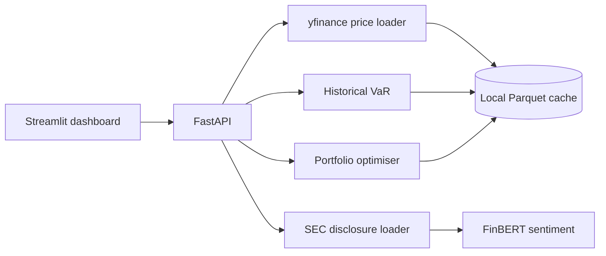

# Neo Screener

**An experimental financial-risk dashboard combining market data, NLP, and portfolio analytics.**

[Source code](https://github.com/HOWITTZER99/neo_screener) · [API](src/api/main.py) · [Dashboard](src/api/dashboard.py) · [Risk logic](src/risk)

> **Project status: prototype.** Some code paths are incomplete and an end-to-end run has not been independently verified. This repository is not a production trading, investment, or risk-management system.

## Why this project?

Risk assessment often involves disconnected inputs: price history, regulatory disclosures, natural-language sentiment, and portfolio statistics. Neo Screener explores how those signals could be placed behind one Python API and a simple dashboard.

## Architecture



## Implemented source modules

| Area | Implementation | Notes |
| --- | --- | --- |
| Price ingestion | [`src/data/price_loader.py`](src/data/price_loader.py) | Uses yfinance and writes Parquet |
| API | [`src/api/main.py`](src/api/main.py) | `/prices`, `/var`, `/weights`, `/sentiment` |
| Web dashboard | [`src/api/dashboard.py`](src/api/dashboard.py) | Streamlit UI for API endpoints |
| Sentiment | [`src/nlp/finbert_service.py`](src/nlp/finbert_service.py) | FinBERT inference on supplied text |
| Risk | [`src/risk/var_calc.py`](src/risk/var_calc.py) | Historical VaR using an equal-weight return series |
| Optimisation | [`src/risk/optimiser.py`](src/risk/optimiser.py) | PyPortfolioOpt integration, currently incomplete |
| Disclosures | [`src/data/text_loader.py`](src/data/text_loader.py) | Experimental SEC data retrieval, needs validation |

## Local development

Requires Python 3.10+ and network access for market data and model weights.

```bash
python -m venv .venv
source .venv/bin/activate  # Windows PowerShell: .venv\Scripts\Activate.ps1
python -m pip install -r requirements.txt

uvicorn src.api.main:app --reload
# In a second terminal with the environment activated:
streamlit run src/api/dashboard.py
```

Browse the API documentation at `http://127.0.0.1:8000/docs` and the dashboard at `http://localhost:8501`.

**Important:** imports initialize FinBERT on API startup, potentially downloading model weights and consuming memory. The data and SEC disclosure endpoints require working upstream services. These commands are the intended developer entry points, not a guarantee all endpoints currently succeed.

## Known limitations and planned improvements

- **SEC disclosures:** replace/validate the `EntityRiskFactors` company-concept request in `text_loader.py` against actual EDGAR 10-K filings; add a compliant descriptive User-Agent, request backoff, caching, and reproducible fixture tests.
- **Portfolio weights:** `optimiser.py` constructs an `EfficientFrontier` but does not call an optimisation method before returning weights. Also standardize annualization and explicitly document assumptions.
- **Reliability:** add schema validation, external API error handling, unit/integration tests, CI, dependency pinning, and Docker configuration.
- **Evaluation:** publish data-source provenance, a fixed-ticker benchmark, latency/cost measurements, sentiment evaluation, and failures.
- **Interpretability:** explain the meaning and limitations of FinBERT confidence and of historical VaR, and separate investment signals from raw metrics.

## Engineering roadmap

1. Make one deterministic end-to-end run pass using recorded SEC and pricing fixtures.
2. Implement validated portfolio optimisation and unit tests.
3. Add caching, typed API responses, structured logs, and CI.
4. Benchmark FastAPI performance and compare FinBERT with at least one alternative.
5. Add a deployable demo, architecture screenshots, and a short results report.

## Tech

Python · FastAPI · Streamlit · PyTorch/Transformers · FinBERT · Pandas · yfinance · PyPortfolioOpt · Parquet

**Disclaimer:** Educational prototype only; not financial advice. No portfolio performance or predictive accuracy is asserted.
